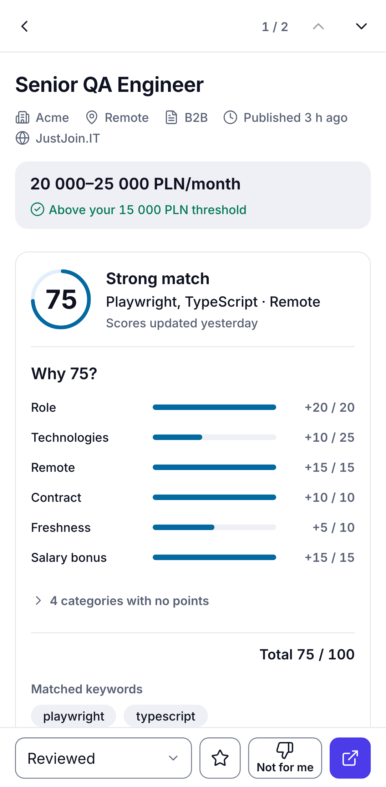
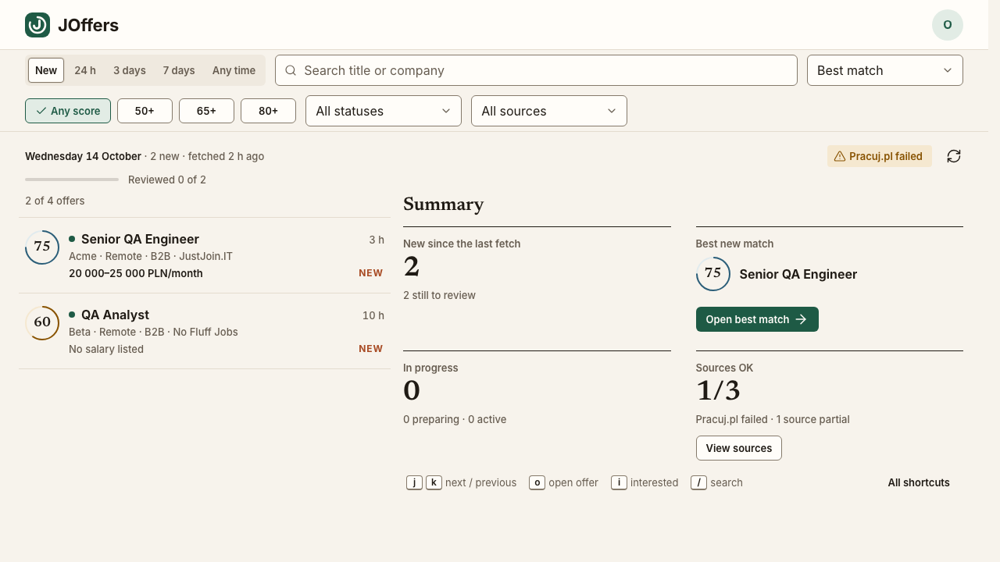
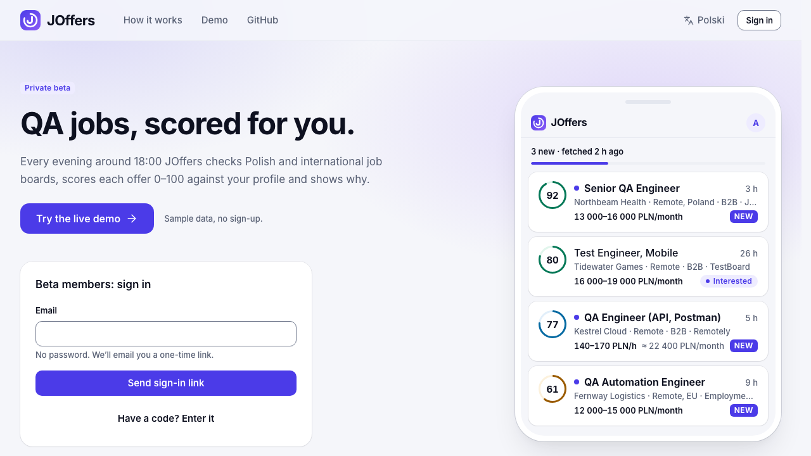

# JOffers — job finder

[](https://github.com/michalszuryga/Job-offers/actions/workflows/tests.yml)

Collects QA job offers from Polish and international job boards, scores them
against a candidate profile, and tracks applications. Runs a full fetch at 11:00
and 18:00 Europe/Warsaw, a light one every 30 minutes on workdays, and e-mails the
new offers after each fetch that found some.

## What it does

- **14 sources:** No Fluff Jobs, Pracuj.pl, JustJoin.IT, Bulldogjob, TestDevJobs,
  CzyJestEldorado (aggregator), RemoteOK, We Work Remotely, Workable's public job
  search (every company on Workable), Himalayas and Solid.jobs (public APIs; full
  fetches only; Himalayas offers link back to Himalayas, as its terms ask), plus companies' own
  ATS job boards (Workable, SmartRecruiters, TalentClue) listed in
  `config/companies.yaml` — mainly IT contractors staffing EU institutions.
- **Potentially remote:** a hybrid or office offer whose text says full remote is
  possible ("hybrid in Gdańsk, fully remote work also possible", Pracuj.pl's
  "praca zdalna, praca hybrydowa") is kept instead of rejected, without remote
  points, with the phrase in `remote_hint`. The web app hides these behind the
  *Work mode* filter (and a "+N potentially remote" link); the e-mail lists them
  in a section of their own.
- **Scoring:** deterministic, explainable 0–100 match score from the profile in
  `config/profile.yaml` (roles, technologies, domains, contract, seniority,
  salary, freshness) plus hard exclusions (e.g. Java-as-a-requirement, junior-only).
- **Deduplication** across boards by normalized title + company; the rescore also
  keeps one visible copy per title + company.
- **Work mode and region:** a board's own work mode (JustJoin.IT's `workplaceType`,
  Pracuj.pl's badges, the ATS remote fields, Solid.jobs flags) is kept in the location
  as " · Remote" / " · Hybrid" / " · Office" and wins over guessing from the text.
  A location naming only a region outside Europe ("USA Only", "LATAM", "Canada")
  is rejected as *Region outside Europe*; a description saying so is not.
- **Lifecycle:** offers you haven't acted on (`TO_REVIEW`, or `REVIEW`, which the
  web app sets when you merely open one) and offers marked Not for me
  (`DISMISSED`) are removed after 14 days without appearing
  on their board, unless you recorded a rate or notice period; anything you've
  triaged further is kept.
- **Tracking:** application status, the rate and notice period you quoted, CV
  highlights matched to each offer. `applied_at` is stamped the first time an
  offer is marked `APPLIED` and is never cleared afterwards: moving the status
  back, or undoing the change, keeps the original date. **Not for me**
  (`DISMISSED`, button or `x` in the web app's details) sets the status and
  moves straight on to the next offer; Undo puts the status back.
- **Summary e-mail** after each fetch (fetch triggered by
  cron-job.org, GitHub's cron as a fallback; sent with Gmail SMTP), listing the
  offers that fetch added, best one in the subject, each with a one-tap
  *Aplikowałem* link (`?offer=…&mark=applied`, sets Applied with Undo). The 11:00
  and 18:00 e-mails always go out; a fast run's only when it found something. The
  full fetches rescore stored offers, so freshness and the stale-offer penalty stay current. If the fetch fails before it records
  anything, the e-mail lists offers first seen in the last 24 h instead and says
  "(24 h)" in the subject.
- **Web app** (`web/`, React + TypeScript) with magic-link sign-in, built for
  phone and laptop; the Streamlit dashboard is being phased out. On a laptop it
  has keyboard triage (`j`/`k`, `o`, `i`, `x`, `/`; `?` lists them all and can
  turn them off).

## Screenshots

<p>
  
  
</p>

*Phone: the day's new offers, and one offer's details with its status actions.*



*Laptop: the list beside a summary of the last fetch; details open in the right pane.*



*The public landing page, with a demo on sample data.*

## Architecture

```
cron-job.org 11/17 ─► GitHub Actions ─┐                                  ┌── Web app (GitHub Pages, Supabase Auth + RLS)
  (GitHub cron :41 = fallback)       ├──► scrapers + scoring ──► Supabase Postgres
Dashboard "Fetch live jobs" ──────────┘     (Python)              ├── Streamlit dashboard (legacy)
                                                                  └──► e-mail summary (Gmail SMTP)
```

- `job_finder/sources/` — one adapter per board, all returning the common `Job` model.
- `job_finder/collector.py` — runs sources concurrently, dedups, bulk-stores, expires stale offers.
- `job_finder/scoring.py` — the match score.
- `job_finder/storage.py` — Postgres when `DATABASE_URL` is set, SQLite otherwise (local dev, tests).
- `job_finder/app.py` — Streamlit dashboard.
- `job_finder/cli.py` — `fetch`, `notify-summary` and `daily-due` (has this slot's fetch run?) for the scheduled run.
- `web/` — the web app; talks to Supabase directly with the publishable key.
- `db/web_access.sql` — row-level security and the one write function the web app may call.

## Run locally

```bash
python -m venv .venv
source .venv/bin/activate
pip install -r requirements-dev.txt
pytest -q
streamlit run streamlit_app.py
python -m job_finder.cli fetch          # one fetch from the terminal
python -m job_finder.cli notify-summary # prints the summary if SMTP_USER is unset
```

Without `DATABASE_URL` everything runs against a local `jobs.db` SQLite file.
To use the shared database, copy `.streamlit/secrets.toml.example` to
`.streamlit/secrets.toml` (gitignored) and fill in the Supabase session-pooler URL.

### Web app

```bash
cd web
cp .env.example .env.local   # Supabase project URL + publishable key
npm install
npm run dev
npx playwright install chromium && npm run test:e2e   # Supabase is mocked
```

**Visual baselines.** `e2e/visual.spec.ts` (`@visual`, opt-in) compares the list and
the details on desktop and phone, light and dark, against PNGs in
`web/e2e/visual.spec.ts-snapshots/`. Baselines are made only in the Linux Playwright
container, so they match CI (macOS and Windows ones are gitignored). To refresh them:

- with Docker: `cd web && npm run test:visual:update`, review the PNGs, commit them; or
- without Docker: run the *Tests* workflow by hand (*Actions → Tests → Run workflow*)
  with **update_baselines** ticked, download the `visual-baselines` artifact, and copy
  its `*-linux.png` files into `web/e2e/visual.spec.ts-snapshots/`.

Once baselines are committed, the workflow's `visual` job compares them on every push
(allowed to fail while it settles; diffs are uploaded as `visual-diffs`).

### Tailor the CV to an offer

```bash
python -m job_finder.cli tailor-cv "<offer URL>"
```

Runs locally through the Claude Code CLI (`claude -p`, your subscription — no API
key, no tools). The base CV is `cv.html` in a folder outside this repo (`../CV`,
or `JOFFERS_CV_DIR`); the tailored `.html` + `.pdf` (headless Chrome) and a `.md`
with the changes and the offer's requirements the CV doesn't cover land in
`<cv dir>/tailored/`. Claude may only re-word and re-order: employers, dates,
roles, education, certificates and languages must match the base CV and skills
must come from it, otherwise nothing is rendered. The offer is read from the
database (`DATABASE_URL`, or `.streamlit/secrets.toml`), or from its page when it
isn't stored; a stored offer moves to *CV generated* unless `--keep-status`.

## Deployment

**Web app** — `.github/workflows/web-pages.yml` deploys `web/` to GitHub Pages.
In Supabase enable the Data API (*Integrations → Data API*) with `public`
exposed. Enable *Settings → Pages → Source: GitHub Actions*, add repository variables
`SUPABASE_URL` and `SUPABASE_PUBLISHABLE_KEY`, and apply `db/web_access.sql`.
Access is limited to users listed in `app_members`; in Supabase Auth set the
Site URL to the Pages URL and turn off new sign-ups once your account exists.

In Supabase *Authentication → Email Templates → Magic Link*, add a line under the
link: `Or enter this code: {{ .Token }}`. An app installed to the iOS home screen
can't receive the link (it opens in Safari), so it signs in with that code instead
("Have a code? Enter it"). Keep *Allow new users to sign up* off: the app asks with
`shouldCreateUser: false`, and an address without an account is told JOffers is in
private beta (which reveals whether an address has an account; accepted for the beta).

The privacy page (`/privacy`) and "Request access" show the data controller and a
contact address: repository variables `CONTROLLER_NAME` and `CONTACT_EMAIL`, which
default to the owner's in `web-pages.yml`.

**Dashboard** — Streamlit Community Cloud, entrypoint `streamlit_app.py`, with
`DATABASE_URL` set under *App settings → Secrets*.

**Scheduled fetch** — `.github/workflows/daily-fetch.yml`. In the GitHub repo
settings add:

| Kind | Name | Value |
|---|---|---|
| Secret | `DATABASE_URL` | same Supabase session-pooler URL as the dashboard |
| Secret | `SMTP_USER` | Gmail address the summary is sent from |
| Secret | `SMTP_PASSWORD` | a Gmail app password (myaccount.google.com/apppasswords) |
| Variable | `SUMMARY_TO` | recipient; defaults to `SMTP_USER` |
| Variable | `APP_URL` | the web app's URL, for this repo `https://michalszuryga.github.io/Job-offers/` (the trailing `/` is optional); the e-mail links to its New view (`?view=new`) and to the best new offer (`?offer=…`) |
Run it once by hand from *Actions → Daily fetch → Run workflow*.

**Daily trigger (cron-job.org)** — GitHub's own cron proved unreliable (in
October 2026 it ran ~4 h late twice and skipped two days), so the punctual
trigger is external. The owner's [cron-job.org](https://cron-job.org) account
(free, no payment details) has two identical jobs, every day at 11:00 and at
18:00 Europe/Warsaw:

- URL: `https://api.github.com/repos/michalszuryga/Job-offers/actions/workflows/daily-fetch.yml/dispatches`
- Method `POST`, body `{"ref":"main","inputs":{"daily":"true"}}`
- Headers: `Accept: application/vnd.github+json`,
  `Authorization: Bearer <token>`, `Content-Type: application/json`
- Token: the fine-grained personal access token `joffers-daily-fetch-trigger`
  (GitHub → Settings → Developer settings → Fine-grained tokens), limited to this
  repository with *Actions: Read and write* only. It can start or cancel
  workflow runs here and nothing else. **It expires on 2027-06-14**:
  when it does, the daily fetch silently falls back to GitHub's cron — create a
  new token and paste it into the cron-job.org job's `Authorization` header.
- Check it works: cron-job.org's job history should show HTTP 204, and
  *Actions → Daily fetch* gets a `workflow_dispatch` run at 11:00 and 18:00.

A third job runs the **fast tier** on workdays: same URL, method and headers, body
`{"ref":"main","inputs":{"tier":"fast"}}`, custom schedule minutes 15 and 45, hours
7–21, Monday–Friday (Europe/Warsaw) — so it never lands on 11:00 / 18:00. It reads
only the sources with `tier = "fast"` (APIs and light listings; not Pracuj.pl or
CzyJestEldorado), never skips, and sends an e-mail only when it found new offers.
Only full fetches count for a slot (meta `last_full_fetch_at`).

Scheduled runs (external or cron) skip when the current slot's fetch already happened — a slot runs
from 11:00 or 18:00 to the next one
(`python -m job_finder.cli daily-due`); a manual *Run workflow* always fetches.
GitHub pauses scheduled workflows after 60 days without repository activity;
the external trigger is not affected.

## Notes

Scrapers read public search pages; respect each site's terms, robots rules and
rate limits. Pracuj.pl, No Fluff Jobs and CzyJestEldorado are fetched serially
and slowly on purpose, and can be skipped with `--skip-sensitive`. CzyJestEldorado blocks GitHub-hosted runners
(HTTP 403), so the scheduled fetch leaves it out with `--skip-source CzyJestEldorado`;
any source can be left out by name the same way.

Never commit `.streamlit/secrets.toml`, `jobs.db` or any API key.
